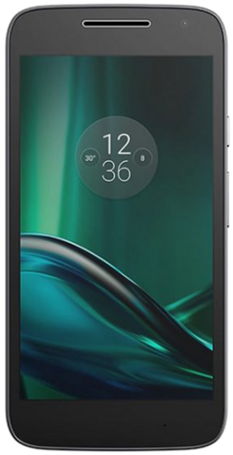

# SushiUI tree for Motorola Moto G Play (2016) (harpia)
(for SushiUI Extended)

Configurations for this SushiUIext device written in Makefile and Shell.



Copyright © 2016 Motorola Mobility LLC. All rights reserved.

Copyright (c) 2026 SushiUI / SushiUI Extended. All rights reserved.

---
If you are installing SushiUI on your device,
```Code
* We not responsible for bricked devices, dead SD cards, thermonuclear war, 
* or you getting fired because the alarm app failed. Please do some research 
* if you have any concerns about features included in this module
* before flashing it! YOU are choosing to make these modifications, and if
* you blame us in any way for what happens to your device, we will laugh at you.
* BOOM! goes the dynamite
```

## Building on harpia
after all
```bash
. ./envsetup.sh
```
then
```bash
make
```

# Maintainers of this device

[rebangkkuser](https://github.com/rebangkkuser) 
